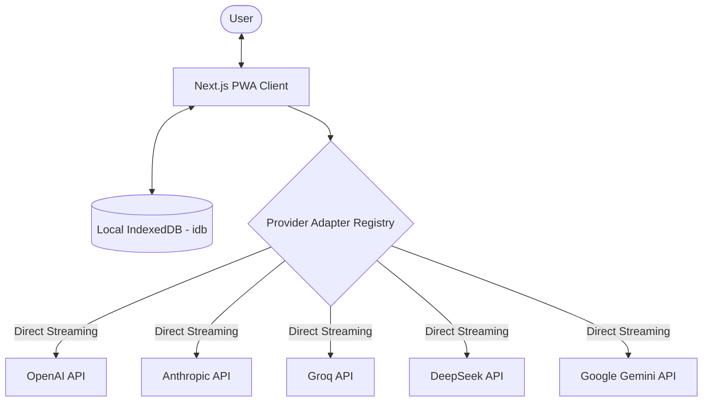

# PrivAI — Zero-Telemetry, Client-Side Multi-LLM Workspace

A privacy-focused web client built with **Next.js**, **TypeScript**, and **IndexedDB** that interfaces directly with major LLM inference providers entirely from the browser. No intermediate servers, no proxy logging, and zero tracking.

---

## What It Solves

Most web interfaces for LLMs route prompts, keys, and chat histories through centralized backend servers. 

PrivAI eliminates the middleman:
- **Direct-to-Provider Streaming:** The client browser dispatches requests directly to OpenAI, Anthropic, Groq, DeepSeek, or Google Gemini.
- **Client-Only Persistence:** Chat histories and user settings are persisted exclusively in local IndexedDB (`idb`), never leaving the user's browser.
- **BYOK (Bring Your Own Key):** API keys are stored in encrypted client-side storage and used only to authorize direct API calls.

---

## Architecture



---

## Technical Highlights

- **Adapter-Based Multi-Provider Engine:** Unified interface (`LLMProviderAdapter`) with custom async generator streaming implementations across five providers:
  - OpenAI (`gpt-4o`, `o1`)
  - Anthropic (`claude-3-5-sonnet`)
  - Groq (Llama 3 ultra-low-latency streaming)
  - DeepSeek (`deepseek-chat`, `deepseek-reasoner`)
  - Google Gemini (`gemini-1.5-pro`, `gemini-1.5-flash`)
- **PWA & Offline Capability:** Custom service worker enabling complete offline loading of past conversations and offline UI state.
- **AbortSignal Integration:** Immediate token streaming cancellation on user stop.

---

## Tech Stack

- **Framework:** Next.js (App Router), React
- **Language:** TypeScript
- **Storage:** IndexedDB (`idb`)
- **Styling:** CSS Modules, Tailwind CSS
- **PWA:** Service Worker (`sw.ts`)

---

## Getting Started

```bash
git clone https://github.com/mmkaya-ui/privai.git
cd privai
npm install
npm run dev
```

Visit [http://localhost:3000](http://localhost:3000) and enter your provider API keys under Settings to start chatting.
