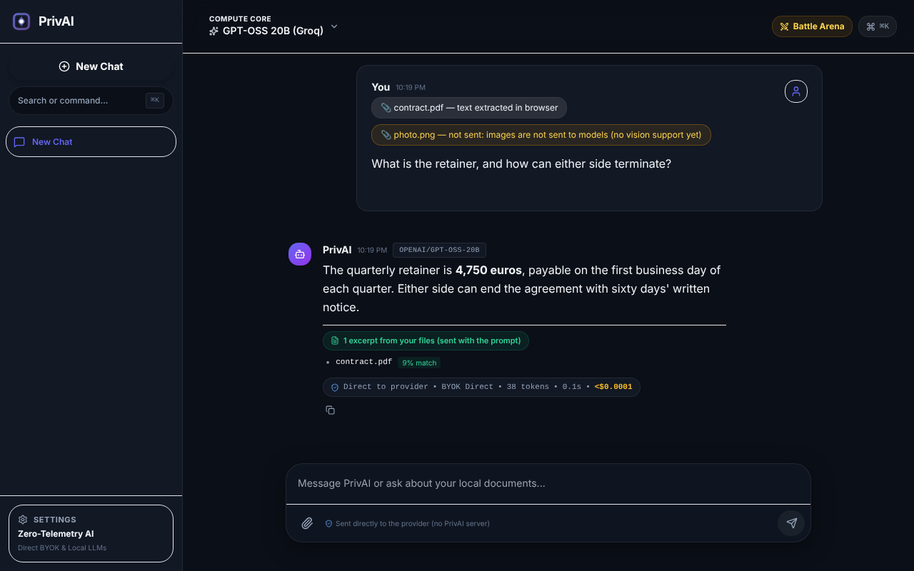
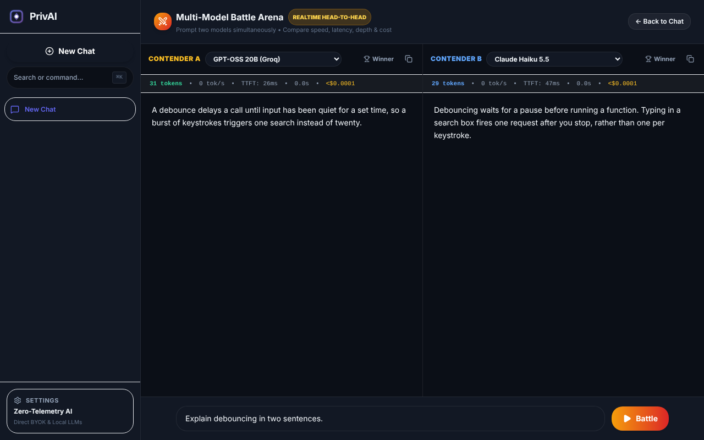

# PrivAI

PrivAI is a chat app that runs in your browser. Bring your own API key for OpenAI, Anthropic,
Gemini, Groq or DeepSeek, or use models on your own machine through Ollama, LM Studio or WebGPU.
Requests go straight from the browser tab to the model you pick. There is no PrivAI server in
between and no account to create.



<sub>Text from the PDF was extracted in the browser and the matching excerpt was added to the
prompt. The image was not sent, and the chat says so. Provider replies in both screenshots are
mocked; regenerate them with `npm run screenshots`.</sub>

## What you get

- Nine backends behind one interface: OpenAI, Anthropic, Gemini, Groq, DeepSeek, any
  OpenAI-compatible URL, Ollama, LM Studio, and WebLLM (Llama 3.2 1B or Gemma 2 2B running on
  WebGPU in the tab).
- Questions about your own files. PDF (via pdf.js), DOCX and text/code files are read in the
  tab, and the most relevant excerpts are added to your prompt.
- Token count, speed and cost under every reply, using the usage numbers the provider reports.
- An Arena that streams one prompt to two models side by side, plus a CLI benchmark.
- Prompt editing with branches, a `Ctrl/⌘+K` command palette, Markdown export, and a sandboxed
  preview for HTML, JS and SVG code blocks.
- Encrypted `.privai` backups for moving your chats and settings to another machine.
- After the first visit the app also loads without an internet connection, which is useful with
  local models.



## Where your data goes

| Data | Where it lives | Encrypted |
| :--- | :--- | :--- |
| Chats, edit history, per-message usage | This browser's IndexedDB (`privai-db`) | No |
| API keys, base URLs, settings | Same database | No |
| Attached files | Nowhere. Text is extracted in memory for one message; only the file name is kept | – |
| `.privai` backup | Wherever you save the file | Yes, AES-256-GCM |

When you chat with a cloud model, your messages and any attachment excerpts go to that provider
and nowhere else. A test loads the app, attaches a PDF and sends a message, and checks that the
only hosts contacted are the app itself and the provider. There is no analytics code and no
font or CDN request.

The one thing to be aware of: keys and chats are stored unencrypted in the browser. Anything that
can read your browser profile, such as malware or an extension with broad permissions, can read
them. A separate browser profile for PrivAI is a reasonable precaution.

## Getting started

Requires Node 20.16 or newer.

```bash
git clone https://github.com/mmkaya-ui/privai.git
cd privai
npm install
npm run dev
```

Open http://localhost:3000, click **Start New Chat**, then pick a model from the menu at the top.
Cloud models appear once you add a key under Settings → Cloud API Keys.

### Ollama

1. Install [Ollama](https://ollama.com) and pull a model, for example `ollama pull llama3.2`.
2. If you serve PrivAI from anywhere other than `localhost`, allow that origin:
   `OLLAMA_ORIGINS="https://your-privai-host" ollama serve`.
3. In PrivAI, open Settings → Local LLMs and click **Test Connection**. Your installed models are
   added to the model menu under "Local Machine (Ollama)" and stay there after a reload.

### LM Studio

Start LM Studio's local server (port 1234) with CORS enabled, then choose
"LM Studio (Active Model)" in the model menu. The default base URL is `http://localhost:1234/v1`.

### WebLLM

Pick one of the in-browser models. The first run downloads the weights from Hugging Face; after
that the browser caches them. This needs a browser with WebGPU support.

## Attachments

Each file is turned into text in the tab, split into 600-character chunks (with 120 characters of
overlap), and ranked against your question with TF-IDF. The top four chunks are added to the
prompt. If nothing matches, for example "summarize this", the opening of each file is used instead.

| File | What happens |
| :--- | :--- |
| Text, Markdown, CSV, JSON, code | Read as UTF-8 |
| PDF with a text layer | Text extracted with pdf.js (bundled; nothing loaded from a CDN) |
| DOCX | Paragraph text read from the document |
| Images, scanned PDFs, XLSX, PPTX, other binaries | Not sent; the message shows "not sent" and why |

Ranking is by keywords, not meaning, so a question worded very differently from the document can
miss the right passage.

## Costs

Costs are calculated from the token counts the provider returns and the list prices below. If a
provider doesn't return counts, PrivAI estimates them (characters ÷ 4) and marks the cost
"(est.)". Local models cost nothing.

Prices in USD per million tokens, standard tier, without caching. Checked against each provider's
pricing page on 2026-10-15 ([record](docs/verification/pricing-2026-10-15.md)).

| Provider | Model | Input | Output | Notes |
| :--- | :--- | ---: | ---: | :--- |
| Anthropic | `claude-opus-5-5` | 4.00 | 20.00 | |
| Anthropic | `claude-sonnet-5-5` | 2.00 | 10.00 | |
| Anthropic | `claude-haiku-5-5` | 0.10 | 0.50 | prompts up to 100K tokens |
| OpenAI | `gpt-6-astra` | 10.00 | 50.00 | short context |
| OpenAI | `gpt-6.1-sol` | 2.00 | 10.00 | short context |
| OpenAI | `gpt-6-luna` | 0.10 | 0.50 | short context |
| Google | `gemini-3.8-flash` | 0.75 | 3.75 | rises to 1.50 / 7.50 on 2027-01-01 |
| Google | `gemini-3.1-flash-lite` | 0.25 | 1.50 | |
| Google | `gemini-3.1-pro-preview` | 2.00 | 12.00 | prompts up to 200K tokens |
| Groq | `openai/gpt-oss-20b` | 0.075 | 0.30 | |
| Groq | `openai/gpt-oss-120b` | 0.15 | 0.60 | |
| DeepSeek | `deepseek-flash` | 0.30 | 1.20 | peak rate; off-peak is half |
| DeepSeek | `deepseek-v4-pro` | 1.32 | 3.96 | peak rate; off-peak is half |

Sources: [Anthropic](https://platform.claude.com/docs/en/about-claude/pricing),
[OpenAI](https://developers.openai.com/api/docs/pricing),
[Google](https://ai.google.dev/gemini-api/docs/pricing),
[Groq](https://console.groq.com/docs/models),
[DeepSeek](https://api-docs.deepseek.com/quick_start/pricing).

## Arena and benchmark

The Arena (the **Battle Arena** button, or `Ctrl/⌘+K` → "Switch to Battle Arena") sends one prompt
to two models at once and shows tokens, time to first token, speed and cost for each.

The benchmark does the same from the command line, several times per prompt, and reports medians
and p90s:

```bash
# keys come from OPENAI_API_KEY, ANTHROPIC_API_KEY, GEMINI_API_KEY, GROQ_API_KEY, DEEPSEEK_API_KEY
npm run bench -- --a ollama:llama3.2 --b groq:openai/gpt-oss-20b --runs 3
npm run bench -- --a anthropic:claude-haiku-5-5 --b deepseek:deepseek-flash --runs 5
npm run bench -- --mock --runs 2   # simulated streams for the default pair; used in CI
```

Results are printed as a table and saved to `benchmarks/results/`.
`benchmarks/results/local-ollama-sample.json` is a single run from the author's machine, included
as an example of the output.

## Encrypted backups

Settings → Encrypted Backups exports everything to a `.privai` file. It is encrypted with
AES-256-GCM, using a key derived from your passphrase with PBKDF2-SHA256 (600,000 iterations, a
fresh random salt and IV each time). The format version and iteration count are authenticated
too, so a tampered header fails to decrypt. Passphrases must be at least 8 characters. Importing
the file on another machine restores your chats, API keys and base URLs.

## The optional `/api/proxy` route

Every built-in provider accepts requests directly from a browser (checked on 2026-10-15 with
[`scripts/cors-probe.browser.js`](scripts/cors-probe.browser.js)), so the app never uses a proxy.
The repo still ships one, for OpenAI-compatible gateways that don't send CORS headers. It runs
wherever Next.js server routes run, and it is locked down:

- It only forwards to an allowlist of provider hosts over HTTPS. IP addresses, private and
  loopback ranges, and cloud metadata addresses are refused in production.
- It only accepts requests from the app's own origin (plus any in `PRIVAI_ALLOWED_ORIGINS`).
- Only a fixed set of headers is forwarded. Cookies never leave, and upstream cookies and
  redirects never come back.
- Request bodies are capped at 1 MiB. Nothing is logged or stored.

## Limitations

- API keys and chats are not encrypted at rest (see above).
- No image input, and no OCR for scanned PDFs.
- Retrieval is keyword-based, not semantic.
- Very large PDFs are processed in the tab and can use a lot of memory.
- No sync between devices; use the encrypted backup.

## How it's tested

Every statement in this README is covered by an automated test or a recorded, dated check. The
end-to-end tests run the production build in Chromium with provider APIs mocked, so they can check
exactly what the app sends and stores without real keys.

| Statement | Checked by |
| :--- | :--- |
| Only the app and the chosen provider are contacted | e2e `privai.spec.ts`: no analytics or third-party requests |
| Keys are stored unencrypted, and the UI doesn't claim otherwise | e2e: privacy copy matches what is stored and sent |
| PDF and DOCX text reaches the prompt; images are refused visibly | `attachments.test.ts` (real files) + three e2e tests |
| Failed or stopped replies aren't sent back to the model | `history.test.ts` + two e2e tests |
| A reply that finishes after you switch chats is saved | `persistence.test.ts` + e2e |
| Ollama models appear in the menu after Test Connection; LM Studio requests go to port 1234 | two e2e tests |
| Prompt editing, the Arena, the command palette, Markdown export, the code sandbox | e2e `features.spec.ts` |
| Offline use after the first visit | e2e |
| Backups round-trip and are encrypted as described | `crypto.test.ts` + e2e |
| Streams parse correctly however the network splits them | `llm-core.test.ts`, `providers.conformance.test.ts` |
| The proxy rejects SSRF and cross-origin use | `proxy-guard.test.ts`, `route.test.ts` |
| Direct browser calls work for all five cloud providers | [CORS probe record](docs/verification/cors-probe-2026-10-15.json) |
| Prices match the providers' pages | [pricing record](docs/verification/pricing-2026-10-15.md) |

Not covered: running a WebLLM model on a real GPU (headless Chromium has no WebGPU, so it's
tested against a mocked engine), real provider replies (they need keys), theme switching, the
"clear chat" action, and the copy and download buttons.

The end-to-end suite was written to reproduce bugs in the previous version: 7 of its 10 regression
tests fail on commit `9dd3a90` and all pass now
([before](docs/verification/e2e-before-9dd3a90.log), [after](docs/verification/e2e-after.log)).

| Command | What it does | Current result |
| :--- | :--- | :--- |
| `npm test` | Unit tests (Vitest) | 304 passing |
| `npm run test:coverage` | Unit tests with coverage; fails below 90% statements, 85% branches | 91.3% statements, 86.3% branches |
| `npm run test:e2e` | End-to-end tests; run `npm run build` first | 17 passing |
| `npm run ci` | Lint, typecheck, coverage, build, mock benchmark | passing |
| `npm run verify` | `ci` plus the end-to-end tests | passing |

GitHub Actions runs all of the above on every pull request and push to `main`. For the end-to-end
tests, run `npx playwright install chromium` once, or point `PW_CHROMIUM_PATH` at an existing
Chromium. Details on each check are in [docs/VERIFICATION.md](docs/VERIFICATION.md); architecture
notes for contributors are in [docs/HANDOVER.md](docs/HANDOVER.md).
