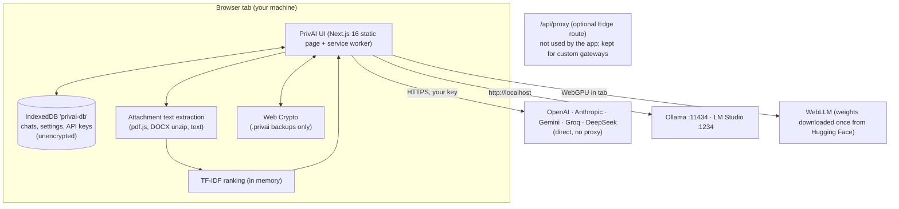

# PrivAI — Client-Side AI Workspace

PrivAI is a browser app for chatting with cloud models using your own API keys (OpenAI, Anthropic,
Google Gemini, Groq, DeepSeek, any OpenAI-compatible endpoint) or with models on your own machine
(Ollama, LM Studio, in-browser WebGPU). There is no PrivAI backend in the chat path: the tab talks
to the provider directly, and chats, settings and keys live in the browser's IndexedDB.

Each claim in this README is backed by an automated test or a dated, recorded check; the
[claims table](#claims-and-how-they-are-verified) says which. The few things that are *not* covered
are listed under [Not covered by tests](#not-covered-by-tests). Run `npm run verify` to re-check
everything.

---

## Claims and how they are verified

| Claim | Verified by |
| :--- | :--- |
| The app contacts only its own origin and the provider you picked: no analytics, fonts or CDNs | e2e: *no analytics or third-party requests* |
| All five cloud providers accept direct browser calls, so no proxy is needed | Browser probe, [docs/verification/cors-probe-2026-10-15.json](docs/verification/cors-probe-2026-10-15.json) |
| API keys and chats are stored **unencrypted** in IndexedDB, and the UI says so | e2e: *privacy copy matches what is actually stored and sent* |
| `.privai` backups are AES-256-GCM / PBKDF2-SHA256 (600k iterations) and round-trip | `crypto.test.ts` (22 tests) + e2e: *encrypted .privai backup round-trips* |
| Text from real PDFs (compressed streams) and DOCX files reaches the prompt | `attachments.test.ts` + e2e: *PDF attachment*, *DOCX attachment* |
| Images are not sent, and the user is told so | e2e: *image attachment* |
| Failed or empty replies are not sent back to the model | `history.test.ts` + e2e: *failed / empty assistant turns* |
| A reply that finishes after you switch chats is saved | `persistence.test.ts` + e2e: *a reply that finishes after switching chats* |
| Ollama "Test Connection" adds your installed models to the model picker | e2e: *Ollama: 'Test Connection'…* |
| The app opens offline after the first visit | e2e: *works offline after the first visit* |
| Stop before the first token shows a notice, and the next request doesn't include it | e2e (features): *Stop before the first token* |
| Editing a sent prompt sends the new version, and old versions stay switchable | e2e (features): *Edit a sent prompt* |
| The Arena streams two providers side by side, with cost from reported usage | e2e (features): *Arena streams two providers* |
| The command palette finds chats by title and exports the current chat to Markdown | e2e (features): *Command palette* |
| "Open in Canvas" runs HTML in an iframe sandboxed with `allow-scripts allow-modals` only | e2e (features): *Code block* |
| LM Studio chat goes to `localhost:1234` and is shown as local and free | e2e (features): *LM Studio* |
| Streams parse correctly however the network splits them | `llm-core.test.ts`, `providers.conformance.test.ts` (each provider split into 1, 2, 3, 7, 64 and 100,000-byte chunks) |
| `/api/proxy` blocks SSRF and open-relay abuse | `proxy-guard.test.ts` (62 tests), `route.test.ts` (15 tests) |
| Model prices match the official pages (2026-10-15) | [docs/verification/pricing-2026-10-15.md](docs/verification/pricing-2026-10-15.md); `models.test.ts` requires every source to be marked verified |
| The production build needs no network access to Google Fonts | `npm run build` in a sandbox that blocks fonts.googleapis.com. The old build failed there: [build-before-9dd3a90.log](docs/verification/build-before-9dd3a90.log) |

Before and after: the regression suite (`e2e/privai.spec.ts`) failed **7 of 10** on commit `9dd3a90`
([log](docs/verification/e2e-before-9dd3a90.log)). Now it and the feature suite (`e2e/features.spec.ts`)
pass **16 of 16** ([log](docs/verification/e2e-after.log)).

### Not covered by tests
- **WebLLM on a real GPU.** Headless Chromium has no WebGPU, so the provider is unit-tested against
  a mocked engine (streaming, usage, interrupt), but a model has not actually been run in this
  verification.
- **Real provider replies.** These need real keys. Tests check the exact request sent, the CORS
  behaviour (probe) and the parsing of each provider's documented stream format.
- **Small UI conveniences:** theme switching, the "clear chat" action, and the copy/download
  buttons.
- **Chrome Local Network Access prompts** when a page not served from localhost calls
  Ollama/LM Studio.

---

## Architecture



- **Direct calls.** Every built-in provider is called straight from the tab. A browser probe on
  2026-10-15 confirmed that Groq, DeepSeek, OpenAI, Anthropic and Gemini all let a page read their
  responses cross-origin. Re-run [`scripts/cors-probe.browser.js`](scripts/cors-probe.browser.js) in
  any browser console to check again.
- **`/api/proxy`** is a hardened pass-through for gateways that do *not* send CORS headers. The app
  never calls it on its own, and it only works when PrivAI is deployed with a server (it is an Edge
  route, so a purely static export does not include it).

---

## What is stored, and where

| Data | Where | Encrypted? |
| :--- | :--- | :--- |
| Chats (messages, edit variants, token telemetry) | IndexedDB `privai-db` → `sessions` | No |
| API keys, base URLs, theme, selected model, discovered Ollama models | IndexedDB `privai-db` → `settings` | No |
| Attached files | Not stored. Text is extracted in memory for one request; only the file name and status are saved with the message | — |
| `.privai` backup file (your download) | Wherever you save it | Yes: AES-256-GCM |
| Anything on a PrivAI server | Nothing. There is no database, and the proxy does not log or store payloads | — |

Anyone or anything that can read this browser profile (malware, an extension with broad
permissions, another person on the machine) can read your keys and chats. Use a dedicated browser
profile and the encrypted backup when moving data.

### Encrypted backups (`.privai`)
- **Cipher and key:** AES-256-GCM. The key is derived from your passphrase with
  PBKDF2-HMAC-SHA256 (600,000 iterations), using a random 16-byte salt and a random 12-byte IV for
  each export.
- **Tamper protection:** the format, version and iteration count are bound in as additional
  authenticated data, so changing the header (for example, lowering the iteration count) makes
  decryption fail.
- **Limits:** minimum passphrase length is 8 characters. Files from an older format (v1, 100k
  iterations) still decrypt.

---

## Threat model of `/api/proxy`

It protects against:
1. **SSRF.** Production targets must be `https://` on port 443 and on the host allowlist
   (`api.openai.com`, `api.anthropic.com`, `api.deepseek.com`, `api.groq.com`,
   `generativelanguage.googleapis.com`, `openrouter.ai`, plus their subdomains), matched on the
   parsed hostname. IP literals, credentials in the URL, loopback, private, link-local,
   cloud-metadata, CGNAT, multicast and IPv4-mapped / NAT64 forms of those are rejected. Loopback
   and private targets are allowed only when `NODE_ENV` is not `production`, so local Ollama works
   in `next dev`.
2. **Open relay.** The `Origin` header must equal the app's own origin, or one listed in
   `PRIVAI_ALLOWED_ORIGINS`. A missing `Origin` is rejected in production.
3. **Header leaks.** Request headers are allowlisted: `content-type`, `authorization`, `x-api-key`,
   `x-goog-api-key`, the `anthropic-*` headers, OpenAI org/project headers and OpenRouter
   attribution. Cookies, hop-by-hop headers and `x-forwarded-*` are never forwarded. On the way back,
   upstream `set-cookie`, `location` and CORS headers are stripped.
4. **Oversized bodies.** Bodies are capped at 1 MiB (`MAX_BODY_BYTES`). A declared length over the
   cap gets a 413 immediately, and chunked bodies are counted as they stream.
5. **Redirects.** `redirect: "manual"`, and any 3xx response becomes a 502.

It does not protect against: the provider seeing your prompt and key (that is the point of the
call), a compromised browser or machine, or your host seeing which upstream hosts you contact.

---

## Attachments and document retrieval

```
file ──► text extraction in the tab ──► 600-char chunks (120 overlap) ──► TF-IDF + cosine ranking ──► top 4 excerpts added to the prompt
```

| File type | What happens |
| :--- | :--- |
| `.txt .md .csv .json`, code, and anything else that decodes as text | Read as UTF-8 |
| PDF with a text layer | Text extracted with pdf.js (`pdfjs-dist`, worker bundled, eval disabled) |
| DOCX | `word/document.xml` unzipped with `fflate`; paragraphs, tabs and breaks kept |
| Images, scanned PDFs, `.xlsx/.pptx/.doc`, other binaries | **Not sent.** The message shows the file as "not sent" with the reason |

- **What leaves the tab:** the whole file never leaves it. The selected excerpts do: they are part
  of the request to whichever model you are using, so a cloud provider sees them.
- **When nothing matches:** if the question shares no terms with the documents ("summarize this"),
  the opening chunks of each file are sent instead, so the model still sees the document.
- **No embeddings, no vector store:** there is no embedding model and no stored index. Everything
  is rebuilt in memory for each message.

---

## Model prices (checked 2026-10-15)

USD per 1M tokens, standard tier, without caching. Each figure was compared with the official page
on that date ([evidence](docs/verification/pricing-2026-10-15.md)). They are used for the per-message
cost shown in the UI.

| Provider | Model ID | Input | Output | Source |
| :--- | :--- | ---: | ---: | :--- |
| Anthropic | `claude-opus-5-5` | 4.00 | 20.00 | [platform.claude.com](https://platform.claude.com/docs/en/about-claude/pricing) |
| Anthropic | `claude-sonnet-5-5` | 2.00 | 10.00 | 〃 |
| Anthropic | `claude-haiku-5-5` | 0.10 | 0.50 | 〃 (prompts ≤ 100K tokens) |
| OpenAI | `gpt-6-astra` | 10.00 | 50.00 | [developers.openai.com](https://developers.openai.com/api/docs/pricing) (short context) |
| OpenAI | `gpt-6.1-sol` | 2.00 | 10.00 | 〃 |
| OpenAI | `gpt-6-luna` | 0.10 | 0.50 | 〃 |
| Google | `gemini-3.8-flash` | 0.75 | 3.75 | [ai.google.dev](https://ai.google.dev/gemini-api/docs/pricing) (until 2026-12-31; then 1.50 / 7.50) |
| Google | `gemini-3.1-flash-lite` | 0.25 | 1.50 | 〃 |
| Google | `gemini-3.1-pro-preview` | 2.00 | 12.00 | 〃 (prompts ≤ 200K tokens) |
| Groq | `openai/gpt-oss-20b` | 0.075 | 0.30 | [console.groq.com](https://console.groq.com/docs/models) |
| Groq | `openai/gpt-oss-120b` | 0.15 | 0.60 | 〃 |
| DeepSeek | `deepseek-flash` | 0.30 | 1.20 | [api-docs.deepseek.com](https://api-docs.deepseek.com/quick_start/pricing) (peak; off-peak is half) |
| DeepSeek | `deepseek-v4-pro` | 1.32 | 3.96 | 〃 |
| Local | Ollama / LM Studio / WebLLM | 0 | 0 | your hardware |

- **Where the cost figure comes from:** each message's cost uses the token counts the provider
  reports. When a provider doesn't report them, characters ÷ 4 is used and the cost is marked
  "(est.)".
- **DeepSeek:** the cost shown uses the peak rate, so it is an upper bound.
- **Training on your data:** each provider's terms govern this. For example, Google's pricing page
  says free-tier Gemini content is used to improve its products, and paid-tier content is not.

---

## Benchmark CLI and Arena

```bash
npm run bench -- --mock --runs 2                         # synthetic streams, no keys or network (runs in CI)
npm run bench -- --modelA ollama:llama3.2 --modelB groq:openai/gpt-oss-20b --runs 3
npm run bench -- --modelA anthropic:claude-sonnet-5-5 --modelB deepseek:deepseek-flash --runs 3
```

- **What it reports:** time to first token (p50/p90), total latency (p50/p90), output tokens per
  second, output tokens, cost, and where the token counts came from. Results print as a markdown
  table and are saved as JSON in `benchmarks/results/`.
- **The sample result file:** `benchmarks/results/local-ollama-sample.json` is one run recorded on
  the author's machine. It is an example of the output format, not a reproducible measurement.
- **Arena (`Ctrl/⌘+K` → Switch to Battle Arena):** streams the same prompt to two models side by
  side, with the same metrics.

---

## Features

- **Providers:** OpenAI, Anthropic, Gemini, Groq, DeepSeek, a custom OpenAI-compatible URL, Ollama,
  LM Studio and WebLLM, all behind one `LLMProvider` interface ([`src/types/llm.ts`](src/types/llm.ts)).
  - Each provider is an async generator: `stream(messages, config, apiKey, signal)` yields
    `{type:'token'}` and `{type:'usage'}` events.
  - Errors are normalized to an `LLMError` with `code` set to `auth`, `rate_limit`, `network`,
    `aborted`, `bad_request`, `not_found`, `server`, `unsupported` or `unknown`, plus `status`,
    `retryable` and `retryAfterMs`.
- **Ollama / LM Studio:** Settings → Local LLMs → **Test Connection** lists the models installed in
  Ollama and adds them to the model picker (the list is remembered).
- **WebLLM:** Llama 3.2 1B and Gemma 2 2B run in the tab on WebGPU. Weights are downloaded once
  from Hugging Face and cached by the browser. Stop interrupts generation on the GPU.
- **Command palette (`Ctrl/⌘+K`):** switch models, jump to chats by title, new chat, export the
  current chat to Markdown, clear the current chat, open settings, switch theme
  (dark / OLED / light), and toggle the Arena. It searches chat titles, not message text.
- **Edit and branch:** edit a sent prompt to create a new version. Earlier versions stay
  switchable.
- **Code blocks:** Prism highlighting and copy/download. HTML, JS and SVG can run in a sandboxed
  iframe (`sandbox="allow-scripts allow-modals"`, no same-origin access).
- **Offline:** a service worker (Serwist) precaches the app after the first online visit. Local
  models keep working offline.

---

## Limitations

1. **Keys and chats are not encrypted at rest.** See [What is stored](#what-is-stored-and-where).
2. **No vision.** Images are not sent to any model.
3. **No OCR.** Scanned PDFs are reported as having no text layer.
4. **Retrieval quality.** Ranking is keyword-based (TF-IDF), not semantic, so paraphrased questions
   can miss the right passage.
5. **Large files.** Extraction runs in the tab, so very large PDFs use a lot of memory.
6. **WebGPU required for WebLLM.** It needs a WebGPU-capable browser and enough GPU memory, and the
   first use downloads the weights.
7. **No sync.** Move data between machines with the encrypted `.privai` export/import.

---

## Local LLM setup

**Ollama**
1. Install Ollama from [ollama.com](https://ollama.com), then pull a model: `ollama pull llama3.2`.
2. If PrivAI is served from anywhere other than `localhost`, allow its origin. For example
   `OLLAMA_ORIGINS="https://your-privai-host" ollama serve` (or `*`, which allows any site to use
   your Ollama).
3. In PrivAI, go to Settings → Local LLMs → **Test Connection**. Your installed models then appear
   under *Local* in the model picker.

**LM Studio**
1. Start the local server (`http://localhost:1234`) and enable CORS in its server settings.
2. Use `http://localhost:1234/v1` as the LM Studio base URL in Settings.

---

## Development and verification

Requires Node 20.16+ (CI uses Node 22).

```bash
git clone https://github.com/mmkaya-ui/privai.git && cd privai
npm install
npm run dev                  # http://localhost:3000
```

| Command | What it runs | Result on this branch |
| :--- | :--- | :--- |
| `npm test` | Vitest unit tests | 13 files, 304 tests passed |
| `npm run test:coverage` | Same, with v8 coverage and **enforced** thresholds (90/85/90/90) | 91.3% statements · 86.3% branches · 92.6% functions · 91.3% lines |
| `npm run lint` / `npm run typecheck` | ESLint / `tsc --noEmit` | clean |
| `npm run build` | `next build --webpack` (Serwist needs webpack) | `/` static, `/api/proxy` Edge |
| `npm run test:e2e` | Playwright against `next start` (run `npm run build` first) | 16 passed |
| `npm run ci` | lint, typecheck, coverage, build, mock benchmark (same as the GitHub workflow) | exit 0 |
| `npm run verify` | `ci`, then the end-to-end tests | exit 0 |

- **Coverage scope:** coverage counts the logic layer: `src/services`, the proxy guard and route,
  persistence and ErrorBoundary. The React UI, store and IndexedDB storage are covered by the
  Playwright suite instead.
- **Before running the end-to-end tests:** `npx playwright install chromium` once, or set
  `PW_CHROMIUM_PATH` to an existing Chromium.

How each check was produced, and how to reproduce it, is in [docs/VERIFICATION.md](docs/VERIFICATION.md).
