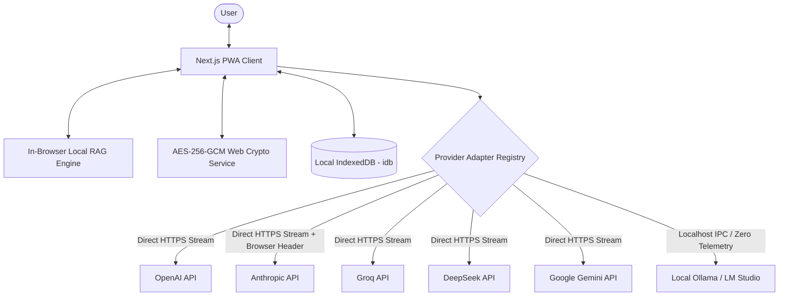

# PrivAI — Zero-Telemetry, Client-Side Multi-LLM Workspace

A privacy-focused, enterprise-grade AI workspace built with **Next.js 16**, **TypeScript**, and **IndexedDB** that interfaces directly with major LLM inference providers entirely from the browser. **No intermediate proxy servers, no telemetry logging, and zero tracking.**

---

## What It Solves

Most web interfaces for LLMs route prompts, proprietary code, sensitive API keys, and conversation histories through centralized backend servers.

**PrivAI eliminates the middleman entirely:**
- **Direct-to-Provider Streaming:** The client browser dispatches requests directly to OpenAI, Anthropic, Groq, DeepSeek, and Google Gemini via async generator streams.
- **Native Local LLMs (Ollama & LM Studio):** Connects directly to local models running on your machine (`http://localhost:11434` or `http://localhost:1234`) with automated model detection and zero network telemetry.
- **Client-Only Persistence:** Chat histories and user settings are persisted exclusively in local IndexedDB (`idb`), never touching an external database.
- **Zero-Knowledge AES-256-GCM Portable Backups (`.privai`):** Export and restore your complete database with PBKDF2 passphrase encryption using the Web Crypto API.
- **In-Browser Local Document RAG:** Drop PDFs, codebases, or Markdown files directly into the workspace. Documents are parsed, chunked, and vector-searched locally inside the browser tab with 0 bytes uploaded to any server.
- **Multi-Model Battle Arena:** Stream 2 models simultaneously side-by-side against a single prompt with real-time speed (tok/s), latency (TTFT), and token telemetry.
- **Split-Screen Artifacts Canvas:** Dedicated interactive drawer to view and run HTML, CSS, JavaScript, and SVG code in an isolated sandbox iframe.

---

## Architecture



---

## Technical Highlights

- **Unified Adapter-Based Multi-Provider Engine:** Standardized interface (`LLMProviderAdapter`) with custom async generator streaming implementations across top models:
  - **Local Runtimes:** Native Ollama (`http://localhost:11434`), LM Studio (`http://localhost:1234/v1`), LocalAI, vLLM
  - **Anthropic:** `claude-3-5-sonnet`, `claude-3-5-haiku` *(with `"anthropic-dangerous-direct-browser-access": "true"` CORS fix)*
  - **OpenAI & Custom Proxies:** `gpt-4o`, `gpt-4o-mini`, `o3-mini`, plus OpenRouter / custom reverse proxy base URLs
  - **Groq:** Ultra-fast Llama 3.3 70B & Mixtral streaming
  - **DeepSeek:** `deepseek-chat` (V3), `deepseek-reasoner` (R1)
  - **Google Gemini:** `gemini-1.5-pro`, `gemini-1.5-flash`
- **In-Browser Document RAG Engine:** Client-side document text extraction, sliding-window chunking, and TF-IDF cosine vector retrieval entirely in the browser thread.
- **Multi-Model Battle Arena:** Head-to-head concurrent streaming benchmark comparing time-to-first-token (TTFT), generation speed, and token output depth.
- **Linear/Raycast Command Palette (`Cmd+K` / `Ctrl+K`):** Global modal for 1-keystroke model switching, full-text history search, theme toggling, and workspace commands.
- **Production-Grade Code Blocks:** Prism syntax highlighting across 10+ languages with 1-click copy, download file, and "Open in Canvas" preview buttons.
- **Client-Side Cryptography:** Master-passphrase AES-256-GCM encryption at rest with PBKDF2 (100,000 rounds) for zero-knowledge `.privai` export and restore.
- **PWA & Offline Capability:** Next.js 16 App Router bundled with Serwist service worker for offline loading and local inference.

---

## Feature Matrix

- [x] **CORS Browser Direct Access:** Anthropic direct browser header + optional zero-log Edge proxy
- [x] **Native Local LLMs:** Ollama and LM Studio auto-discovery and offline chat
- [x] **In-Browser Local Document RAG:** Zero-server PDF/Markdown/Code chunking and vector retrieval
- [x] **Multi-Model Battle Arena:** Concurrent side-by-side model benchmarking
- [x] **Command Palette (`Cmd+K`):** Raycast-style instant model switcher and search
- [x] **Split-Screen Artifacts Canvas:** Live sandboxed HTML/JS/SVG preview runner
- [x] **Client-Side Cryptography:** AES-256-GCM encrypted `.privai` backups
- [x] **Production Syntax Highlighting:** Tokyo Night / GitHub Dark themes with Prism
- [x] **Live Token & Cost Telemetry:** Real-time tokens, tok/s, duration, and BYOK cost pill

---

## Tech Stack

- **Framework:** Next.js 16 (App Router), React 19
- **Language:** TypeScript
- **State & Storage:** IndexedDB (`idb`)
- **Cryptography:** Web Crypto API (`SubtleCrypto` AES-GCM + PBKDF2)
- **Syntax Highlighting:** Prism.js
- **Icons & Motion:** Lucide Icons, Framer Motion
- **PWA Service Worker:** `@serwist/next`, `@serwist/sw`

---

## Getting Started

### 1. Installation

```bash
git clone https://github.com/mmkaya-ui/privai.git
cd privai
npm install
```

### 2. Development

```bash
npm run dev
```

Visit [http://localhost:3000](http://localhost:3000). Use <kbd>Ctrl+K</kbd> or <kbd>⌘K</kbd> to open the Command Palette, switch models, or open **Settings** to configure Ollama or your BYOK keys.

### 3. Production Build

```bash
npm run build
npm run start
```
