# PrivAI — Zero-Telemetry Client-Side AI Workspace

A zero-telemetry, developer-grade AI workspace running directly in your browser. PrivAI connects directly to commercial LLM inference APIs (OpenAI, Anthropic, DeepSeek, Groq, Google) and local machines (Ollama, LM Studio, in-browser WebGPU) with **no application server, no middleman database, and zero tracking**.

---

## The Problem PrivAI Solves

### 1. The \$720/Year Subscription Trap vs. Wholesale Token Pricing
Commercial web interfaces bundle models behind fixed **\$20/month subscriptions** (ChatGPT Plus, Claude Pro, Gemini Advanced). Maintaining access across ecosystems easily totals **\$60/month (\$720/year)**.

- **Wholesale BYOK Reality:** When using raw developer APIs directly, costs are billed per token:
  - **DeepSeek V3:** ~\$0.14 per 1,000,000 input tokens
  - **GPT-4o-mini:** ~\$0.15 per 1,000,000 input tokens
  - **Claude 3.5 Haiku:** ~\$0.80 per 1,000,000 input tokens
- An active developer or researcher typically consumes **\$1.50 to \$3.00/month** in tokens for the exact same foundation models—saving **~95% to 98%**. PrivAI displays this telemetry live under each message.

### 2. The Middleman Database Vulnerability
Most open-source or self-hosted AI clients (LibreChat, Open WebUI, web chat wrappers) require an application backend and database (Node.js, PostgreSQL, MongoDB, Supabase).
- If that server or database is compromised, **every plaintext prompt, proprietary source file, and API key is exposed**.
- **PrivAI has no application server.** It is a static Progressive Web App (PWA). All chat sessions, API keys, and configurations are stored in your browser's private IndexedDB (`idb`) and encrypted at rest with **AES-256-GCM** using a master passphrase.

### 3. Document Privacy in Retrieval (RAG)
When you upload a confidential contract, financial statement, or private code to ChatGPT or Claude Web, the entire file is transmitted to cloud storage and processed through cloud vector pipelines.
- **PrivAI In-Browser RAG:** Documents (PDFs, Markdown, source code) are parsed, chunked, and vector-searched locally inside the browser tab using an in-memory TF-IDF cosine similarity engine.
- **0 bytes of the raw document leave your computer.** Only the 2–3 matching snippets needed to answer the immediate prompt are sent to the model.

---

## Architecture & Threat Model

```mermaid
flowchart TD
    subgraph Client_Boundary ["Client Security Boundary (Your Machine)"]
        UI["PrivAI Next.js 16 PWA Client"]
        IDB[("Encrypted Local IndexedDB (idb)")]
        LocalRAG["In-Browser Vector RAG Engine\n(TF-IDF Cosine Similarity)"]
        CryptoService["Web Crypto API\n(AES-256-GCM + PBKDF2)"]

        UI <--> IDB
        UI <--> LocalRAG
        UI <--> CryptoService
    end

    subgraph Inference_Endpoints ["Inference Endpoints"]
        UI -->|Direct HTTPS Stream + Browser Header| Anthropic["Anthropic API"]
        UI -->|Direct HTTPS Stream| OpenAI["OpenAI / Custom Base URLs"]
        UI -->|Direct HTTPS Stream| DeepSeek["DeepSeek API"]
        UI -->|Direct HTTPS Stream| Groq["Groq API (LPU Inference)"]
        UI -->|Direct HTTPS Stream| Gemini["Google Gemini API"]
        UI -->|Localhost IPC / Zero Internet Traffic| Ollama["Local Ollama / LM Studio (11434 / 1234)"]
        UI -->|In-Tab WebGPU / Zero Network Packets| WebLLM["WebLLM (Llama 3.2 / Gemma 2)"]
    end
```



### Data Boundary Breakdown

| Data Asset | Traditional Web Chat (ChatGPT / Claude) | Standard Self-Hosted (LibreChat / Open WebUI) | PrivAI Workspace |
| :--- | :--- | :--- | :--- |
| **Chat History Storage** | Vendor Cloud Database | Middleman Database (Postgres / Mongo) | **Local IndexedDB (Your Browser Only)** |
| **API Keys & Passphrases** | Stored on Vendor Servers | Stored on App Server | **Local Storage / Encrypted with AES-256-GCM** |
| **Document Uploads (RAG)** | Transmitted to Cloud Vector DB | Transmitted to App Server Embedding Pipeline | **0 Bytes Uploaded (Parsed & Searched in Tab)** |
| **Telemetry & Analytics** | Active (Mixpanel, Datadog, Internal Trackers) | Varies (Docker server logs all user requests) | **0% (Zero analytics SDKs, zero request logging)** |
| **Model Training on Prompts** | Opt-out required on consumer web tiers | Dependent on keys used | **Excluded by default via Commercial API Terms** |
| **Air-Gapped / Offline Use** | Impossible | Requires running full Docker container stack | **Supported out-of-the-box (Localhost & WebGPU)** |

---

## Core Capabilities

### Direct-to-Provider Streaming
- Directly streams from provider endpoints via asynchronous generator streams (`ReadableStream`).
- Includes direct browser CORS handling (`"anthropic-dangerous-direct-browser-access": "true"` for Anthropic) and an optional stateless, zero-log Next.js Edge proxy route (`/api/proxy`) for endpoints requiring header normalization.
- Supports custom base URLs (OpenRouter, Cloudflare AI Gateway, self-hosted proxies).

### Native Local Machine LLMs (Ollama & LM Studio)
- Native adapter connects directly to `http://localhost:11434` (Ollama) or `http://localhost:1234/v1` (LM Studio).
- Automated connection tester and model auto-discovery with ping latency reporting.
- Operates 100% offline with zero internet packets sent.

### In-Browser WebGPU LLMs (`@mlc-ai/web-llm`)
- Runs lightweight foundation models (`Llama-3.2-1B-Instruct`, `Gemma-2-2B-it`) directly inside the browser tab using WebGPU hardware acceleration.
- Requires no local CLI installation. Once model weights are cached in browser CacheStorage, inference runs entirely offline inside the browser tab.

### In-Browser Document RAG Engine
- Drop PDF, Markdown, TypeScript, Python, or plaintext files into the prompt area.
- Ingests text, applies sliding-window chunking, computes term-frequency matrices, and extracts cosine-ranked semantic matches directly on the client thread.
- Displays match confidence pills (`Match Relevance: 84%`) on generated assistant messages.

### Multi-Model Battle Arena
- Real-time head-to-head benchmarking. Submit a prompt once and stream two different models simultaneously side-by-side (e.g., Claude 3.5 Sonnet vs. DeepSeek R1).
- Live metrics display: **Time-to-First-Token (TTFT)**, **tokens/sec**, **total tokens generated**, and **winner voting**.

### Linear/Raycast Command Palette (`Cmd+K` / `Ctrl+K`)
- Switch models in one keystroke.
- Full-text search across all IndexedDB conversation history.
- Quick actions: clear context, toggle Battle Arena, export backup, toggle dark/OLED themes.

### Split-Screen Artifacts Canvas & Live Code Sandbox
- Multi-language syntax highlighting powered by Prism (Tokyo Night / GitHub Dark themes).
- 1-click code copying, dynamic file downloading with automatic file extensions, and an isolated `<iframe>` runner sandbox to execute HTML, JavaScript, and SVG snippets in real time.

### Conversation Branching (`< 1 / 2 >`)
- In-place prompt editing creates persistent conversation branch trees. Traverse alternate prompt iterations without losing original outputs.

### Zero-Knowledge Encrypted Backups (`.privai`)
- Single-click export of your entire IndexedDB database into an encrypted `.privai` file using **AES-256-GCM** with a PBKDF2-derived key (100,000 iterations).
- Seamlessly restore conversations on another machine without creating a cloud account.

---

## Local LLM Setup Guide (Ollama & LM Studio)

PrivAI can connect directly to open-source models running locally on your hardware.

### Connecting to Ollama (60-Second Setup)

1. **Install Ollama:** Download from [ollama.com](https://ollama.com) (macOS, Windows, Linux).
2. **Enable Browser CORS:** Since PrivAI runs in your browser, Ollama needs permission to accept browser requests:
   - **macOS / Linux:**
     ```bash
     OLLAMA_ORIGINS="*" ollama serve
     ```
   - **Windows (PowerShell):**
     ```powershell
     $env:OLLAMA_ORIGINS="*"
     ollama serve
     ```
3. **Pull a Model:**
   ```bash
   ollama run llama3.2
   # or DeepSeek R1 reasoning model:
   ollama run deepseek-r1:8b
   ```
4. **Auto-Discovery in PrivAI:** Open PrivAI $\to$ **Settings** $\to$ **Local LLMs** $\to$ click **Test Connection**. PrivAI will detect your local Ollama instance and automatically populate all installed models into the selector.

### Connecting to LM Studio / LocalAI

1. Open **LM Studio**, navigate to the **Local Server** tab (`<->`), and click **Start Server** (`http://localhost:1234`).
2. Ensure **CORS** is enabled in the LM Studio server settings.
3. In PrivAI **Settings**, set `http://localhost:1234/v1` as the LM Studio Base URL.

---

## Tech Stack & Verification

- **Framework:** Next.js 16 (App Router), React 19
- **Type Safety:** TypeScript (strict mode, zero `any` policy)
- **Local Database:** IndexedDB via `idb`
- **In-Browser WebGPU:** `@mlc-ai/web-llm`
- **Cryptography:** Web Crypto API (`SubtleCrypto` AES-256-GCM, PBKDF2)
- **PWA Service Worker:** `@serwist/next`, `@serwist/sw` (offline precaching)
- **Syntax Engine:** Prism.js

### Running Tests

PrivAI includes automated unit testing for cryptographic roundtrips, in-memory document RAG, provider streaming, and simulated end-to-end prompt processing:

```bash
# Run all tests (AES-256-GCM crypto, Local RAG, Provider streams & E2E prompt simulation)
npm test

# Run the end-to-end simulated prompt stream test only
npm run test:prompt

# Run ESLint validation
npm run lint

# Build for production
npm run build
```

---

## Getting Started

```bash
git clone https://github.com/mmkaya-ui/privai.git
cd privai
npm install
npm run dev
```

Open [http://localhost:3000](http://localhost:3000). Use <kbd>Ctrl+K</kbd> or <kbd>⌘K</kbd> to open the Command Palette, switch models, or open **Settings** to configure Ollama or your BYOK keys.
